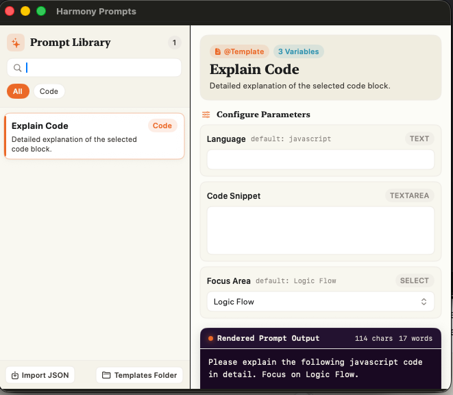
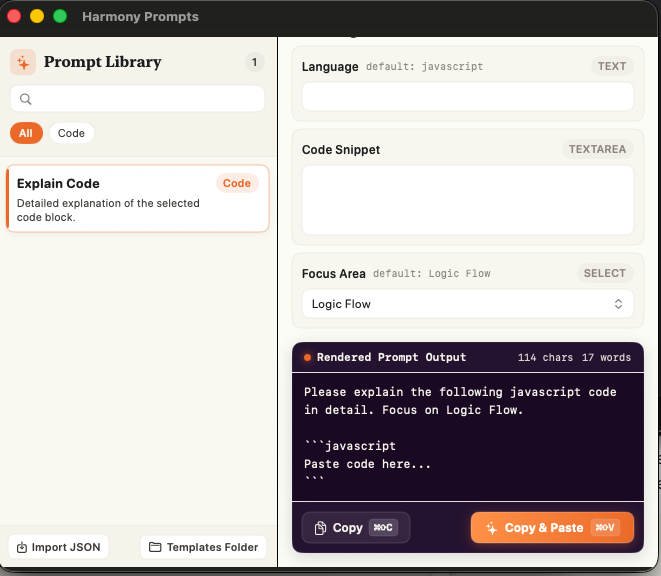

# Harmony Prompts

**A private, offline workspace for reusable AI prompts.**

Create prompt templates, fill in structured fields, and preview the result before copying it into your workflow. Available as native apps for macOS and Windows, with a shared JSON template format.

[macOS](#macos) · [Windows](#windows) · [Privacy & security](#privacy--security)

## Product preview

| Template library | Live preview |
| :---: | :---: |
|  |  |
| Browse templates and configure dynamic fields. | Review the rendered prompt, then copy or paste it into your workflow. |

## Designed for everyday use

- **Reusable templates** — Keep frequently used prompts organized and ready to adapt.
- **Structured fields** — Customize prompts with five dynamic field types instead of rewriting them each time.
- **Live preview** — Review the rendered prompt and its character and word counts before you use it.
- **Quick handoff** — Copy on both platforms; macOS also supports one-step paste.
- **Shared format** — Use compatible JSON templates across the macOS and Windows apps.

## macOS

Open Harmony Prompts from the menu bar while working in Cursor, VS Code, a browser, Terminal, or another app.

**Install:**

```bash
curl -fsSL https://raw.githubusercontent.com/Poseidoncode/HarmonyApp/main/install.sh | bash
```

The installer requires macOS 14.0+ and Xcode. You can also [build from source](HarmonyPrompts/README.md#build-from-source) or open `HarmonyPrompts/HarmonyPrompts.xcodeproj` in Xcode.

**Get started:** Launch Harmony Prompts from `/Applications` or Spotlight, open it from the menu bar, then choose a template and select **Copy** (`⌘C`) or **Copy & Paste** (`⌘⌥V`). Run the app from `/Applications/Harmony Prompts.app` so Accessibility permission remains valid.

**Paste permission:** **Copy & Paste** requires enabling Harmony Prompts under **System Settings → Privacy & Security → Accessibility**. Until then, use **Copy** and press `⌘V` manually.

## Windows

The Windows app is a native WPF application with notification-area access. **A Windows release has not been published yet.** The [Windows guide](Windows/README.md) covers development, building, and portable packaging with the .NET 10 SDK. See the [implementation status](Windows/IMPLEMENTATION_STATUS.md) for verification details.

Auto Paste is off by default. Copying and pasting manually with **Ctrl+V** is the recommended mode; Settings offers experimental, session-only opt-in.

## Privacy & security

Harmony Prompts runs locally, with no telemetry or outbound network requests. Templates and prompt evaluations remain on your device. See [SECURITY.md](SECURITY.md) for security policies and vulnerability reporting.
